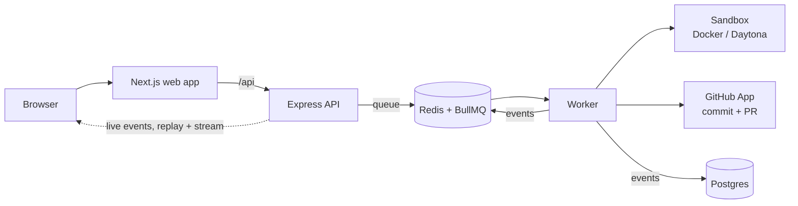

<p align="center">
  <picture>
    <source media="(prefers-color-scheme: dark)" srcset="apps/web/public/brand/white/codegenie_logo_white_transparent.png">
    
  </picture>
</p>

<p align="center">
  <b>Describe a coding task. Get a pull request.</b><br>
  An autonomous coding agent that does the work in an isolated cloud sandbox and opens the PR for you.
</p>

<p align="center">
  <a href="https://github.com/shilendra-cse/codegenie/actions/workflows/ci.yml"></a>
  
  
  
  
  
</p>

<p align="center">
  <a href="#how-it-works">How it works</a> ·
  <a href="#getting-started">Getting started</a> ·
  <a href="#documentation">Docs</a>
</p>

> **Status:** in development, working towards the MVP. See the [development plan](docs/knowledge/development-plan.md).

## How it works

1. **Connect GitHub.** Sign in with GitHub and install the CodeGenie App on the repositories it may work on.
2. **Set up once.** CodeGenie works out how to install and check each repository, tries it, and asks you a multiple-choice question only when it can't decide. Every task replays that setup.
3. **Describe a task.** "Add a /health endpoint with a test."
4. **Watch it work.** The agent reads, edits and runs commands in its own sandbox; you follow every step live.
5. **Get the PR.** A pull request from `codegenie[bot]` with a summary and the check results: ready when the checks pass, a draft when they don't.



## Features

- **Guided environment setup:** rules first, an AI setup agent for the hard cases, at most 5 questions, and everything kept has actually run in a fresh sandbox.
- **Live run view:** stages, files read and edited, commands and their output, the diff; a reload picks up where it was.
- **Honest pull requests:** lint, type-check and tests run before and after the change; a draft PR when they fail, no PR when nothing needed changing.
- **Safe by design:** user code runs only in sandboxes; GitHub tokens are scoped to one repository, expire within an hour and are never stored where the agent can read them; the commit and PR go through GitHub's API from the worker.
- **Limits and cancel:** every run stops at 30 minutes, 150 steps or $2, and Cancel stops it any time.
- **Measured:** an eval set of real tasks on real repositories grades every change to the agent.

## Built with

Next.js · React · Tailwind · TanStack Query · Express · Better Auth · BullMQ + Redis · Postgres + Drizzle · Vercel AI SDK · Daytona · Docker · GitHub App · Vitest · Playwright

## Repository layout

```
apps/
  web/        Next.js UI
  server/     Express API (auth, projects, tasks, live run events)
  worker/     Runs queued tasks and project onboarding
  cli/        Run a task from the terminal (pnpm agent:setup, pnpm agent:run)
  evals/      Eval tasks and the harness that grades the agent (pnpm eval)
  e2e/        Playwright end-to-end journey (pnpm e2e)
packages/
  runner/     Runs a task end to end: sandbox, checkout, setup, agent, verify
  agent/      The AI agent: model, prompt, tools, loop
  sandbox/    Isolated environments (Docker locally, Daytona in the cloud)
  db/         Postgres schema, client, migrations and queries, shared by server and worker
  github/     GitHub App access: repo-scoped tokens, the bot identity, webhook signatures
  terminal/   Terminal output shared by the CLI and evals (colors, layout, spinners)
  shared/     Types shared across apps and packages
docs/
  api/        OpenAPI spec
  knowledge/  Requirements, architecture, database and development plan
script/       Setup and migration scripts
```

## Prerequisites

- Node.js 24
- pnpm 10 (`corepack enable`)
- Docker (Postgres and Redis run in containers)

## Getting started

```bash
pnpm setup
```

This installs dependencies, creates `.env` files from the examples, starts Postgres and Redis, and runs database migrations. Then fill in the credentials it warns about:

- `apps/server/.env`: the GitHub App's client id and secret, App id, private key and webhook secret ([docs/knowledge/github.md](docs/knowledge/github.md))
- `apps/cli/.env`: `OPENAI_API_KEY` (and optionally `AGENT_MODEL`)
- `apps/worker/.env`: `OPENAI_API_KEY`, the GitHub App's `GITHUB_APP_ID` and `GITHUB_APP_PRIVATE_KEY` (and optionally `AGENT_MODEL`, `WORKER_CONCURRENCY`)

Start each app in its own terminal:

```bash
pnpm dev:server   # API at http://localhost:3001
pnpm dev:web      # UI at http://localhost:3000
pnpm dev:worker   # runs queued work; see apps/worker/README.md
pnpm dev:webhooks # forwards GitHub webhooks from your smee channel (docs/knowledge/github.md)
```

Run the agent on a repository:

```bash
pnpm sandbox:build-image   # once, and after sandbox image changes
pnpm agent:setup --repo ../my-project      # once per repository; saved in ~/.codegenie
pnpm agent:setup --repo ../my-project --show
pnpm agent:run --repo ../my-project --task "Add a /health endpoint with a test"
pnpm agent:run --help      # all options
pnpm eval                  # run the eval tasks (real model runs; costs money)
```

Sign in at http://localhost:3000/signin.

## Common commands

| Command | What it does |
|---|---|
| `pnpm migrate` | Apply database migrations |
| `pnpm --filter @codegenie/db generate` | Write a migration after a schema change (`packages/db/src/schema/`) |
| `pnpm db:studio` | Browse the database (Drizzle Studio) |
| `pnpm sandbox:build-snapshot` | Build the Daytona snapshot, once per account (reads `apps/worker/.env`) |
| `pnpm sandbox:clean` | Remove leftover local sandbox containers |
| `pnpm lint` | Lint all packages |
| `pnpm typecheck` | Type-check all packages |
| `pnpm format:check` | Check formatting in the packages that have it |
| `pnpm test` | Run all tests (Vitest) |
| `pnpm build` | Build all packages |
| `pnpm e2e` | Run the end-to-end journey in Playwright, on demand ([web.md](docs/knowledge/web.md) §19) |
| `pnpm e2e:report` | Open the last end-to-end report |

API docs are served at http://localhost:3001/api/docs while the server is running.

## Documentation

- [Requirements](docs/knowledge/requirements.md)
- [Architecture](docs/knowledge/architecture.md)
- [Database](docs/knowledge/database.md)
- [Development plan](docs/knowledge/development-plan.md)
- [API](docs/knowledge/api.md), [Web app](docs/knowledge/web.md), [Web UI](docs/knowledge/ui.md)
- [Runner](docs/knowledge/runner.md), [Environment](docs/knowledge/environment.md), [Agent](docs/knowledge/agent.md), [Sandbox](docs/knowledge/sandbox.md), [GitHub](docs/knowledge/github.md), [Evals](docs/knowledge/evals.md)

## License

ISC
